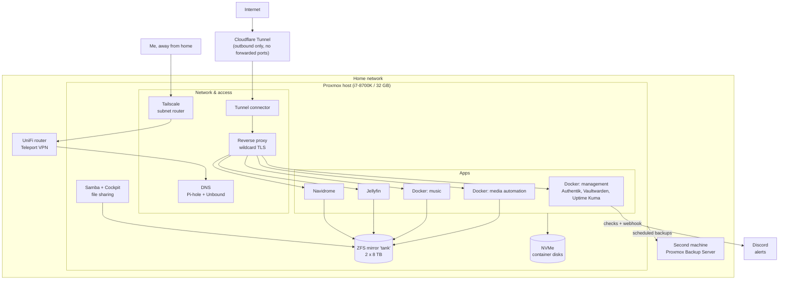

# Home Lab

> A light overview of the current version of my lab. For the longer, more detailed story of how it was built, see the [Homelab series on joaoguedes.net](https://joaoguedes.net/blog/the-frankenlab).

It has been serving my self-hosted apps since 2022. It started as a free machine built from leftovers and was rebuilt into a single, quiet and powerful Proxmox host that I treat like a small production environment with least privilege, one login for everything, backups I actually verify, and alerts that reach my phone.

### Live status

Real data from my [Uptime Kuma status page](https://uptime.joaoguedes.net):

| Service | Status | 30-day uptime |
|---|---|---|
| Jellyfin |  |  |
| Navidrome |  |  |
| Seerr |  |  |
| Pi-hole DNS |  |  |

---

## At a glance

| | |
|---|---|
| **Hypervisor** | Proxmox VE running LXC containers and VMs |
| **Compute** | Intel Core i7-8700K (6C/12T), 32 GB DDR4, Intel UHD 630 for transcoding. Reused from an old gaming rig |
| **Storage** | 1 TB NVMe for Proxmox and container disks, 2 × 8 TB ZFS mirror for data |
| **Network** | UniFi router, Pi-hole + Unbound for DNS, wildcard certificate behind a reverse proxy |
| **Identity** | Authentik SSO, Vaultwarden |
| **Remote access** | Tailscale subnet router and Teleport for me, Cloudflare Tunnel for the few services that are meant to be public |
| **Backups** | Proxmox Backup Server on a second machine + ZFS mirror and scrubs |
| **Monitoring** | Uptime Kuma, a host health script and heartbeats, all reporting to Discord |

---

## Architecture

### What runs where

| Container | Role |
|---|---|
| DNS | Pi-hole with its own recursive resolver (Unbound), so ads are blocked and I can forward traffic through my reverse proxy |
| Reverse proxy | Clean names and a wildcard certificate for every service |
| VPN | Tailscale subnet router so I can have remote access in WAN |
| File sharing | Samba, managed through Cockpit, so every device sees the media as a network drive |
| Docker (management) | Authentik, Vaultwarden, Uptime Kuma and other admin apps |
| Docker (media automation) | Seerr, Radarr, Sonarr, Bazarr and the rest of the arr stack and support apps|
| Docker (music) | Soulseek and music tooling |
| Jellyfin / Navidrome | Multimedia streaming services |
| Tunnel | Cloudflare connector for the few public services |

---

## Design decisions

- **LXC over VMs.** Containers share the host kernel, start in seconds and cost almost no RAM. Ten of them use less than 15% of my machine. I harden what I can (unprivileged where possible) and accept the remaining privileged ones as a conscious trade-off.
- **ZFS owns the disks.** A mirror survives a dead drive, checksums catch silent corruption, and a monthly scrub repairs it. All media lives in one dataset so downloads can be *hardlinked* into the library instead of copied.
- **One identity.** Management apps sit behind Authentik.
- **Don't expose what you don't need.** Nothing listens on my home connection. Sensitive tools are LAN/VPN only, and only public facing services are published through the tunnel.
- **Back up what is irreplaceable.** The whole lab is backed up at the Proxmox level, but I only back up *data* I can't get back (photos, home videos, configs). Media can be re-downloaded and/or re-ripped.
- **Boring monitoring.** No heavy stack. Uptime Kuma checks the services, a script checks the host through a cron job and heartbeats check that the monitoring itself is still alive.

---

## Security model

| Layer | Approach |
|---|---|
| **Ingress** | Cloudflare Tunnel (outbound connection), no inbound port forwarding |
| **Admin access** | Only from the LAN or over VPN (Tailscale / Teleport) |
| **Identity** | SSO + MFA through Authentik |
| **Isolation** | One container per role, unprivileged where possible, same service account UID/GID only for services that share media |
| **Storage** | Bind-mount only the paths a service needs |
| **Recovery** | PBS backups, ZFS mirror and scrubs, SMART tests, all verified on a schedule |

### Threat model

| Threat | Vector | Mitigation |
|---|---|---|
| Unauthorized remote access | Exposed services | No forwarded ports, tunnel only for shared apps behind accounts, admin over VPN |
| Credential theft | Phished or reused password | Vaultwarden, unique passwords, MFA at the Authentik layer |
| Container breakout | Vulnerability in an app | Per-role containers, unprivileged where possible, scoped mounts |
| Vulnerable public app | Unpatched service behind the tunnel | Cloudflare proxy in front, prompt updates, share as little as possible |
| Data loss | Disk failure, bad update, ransomware, fire | ZFS mirror, scheduled PBS backups with verification; off-site copy is next |
| Silent failure | Alerts or monitoring stop working | Heartbeats that notify me when the monitoring itself goes quiet |

---

## What's next

- Off-site copy of the irreplaceable data, to complete the 3-2-1 rule
- Nightly instead of weekly backups
- Immich for photos (once the backups are sorted), Paperless-ngx, Mealie and Komga
- Karakeep or Linkwarden for saved links
- VLAN segmentation (IoT, management, media)
- OpenTelemetry pipeline for metrics, logs and traces
